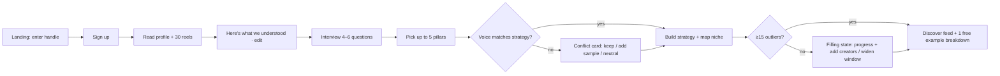
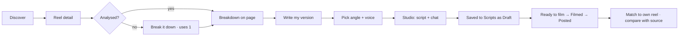
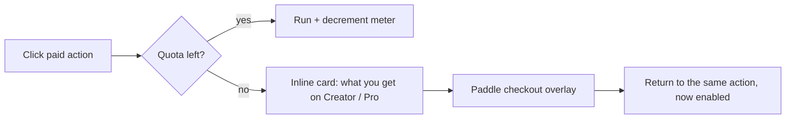

# 02 · Information architecture

## 1. Core objects

| Object | What it is | Key fields | Relationships |
| --- | --- | --- | --- |
| **Account** | A signed-in person | email, name, plan | owns 1+ Workspaces |
| **Workspace** | Billing and seats boundary | plan, seats, period_start | has many Creators |
| **Creator (profile)** | The brand being written for (the user, or a client) | ig_handle, name, avatar, language | has Strategy, Voice, Tracked accounts, Scripts |
| **Tracked account** | A niche account we watch | handle, followers, usual_views, last_scraped_at | belongs to many Creators |
| **Reel** | A public reel from a tracked account or the creator's own | shortcode, views, likes, comments, posted_at, duration, thumbnail, caption, transcript | belongs to an Instagram account; has Snapshots and a Breakdown |
| **Snapshot** | Views at a point in time | reel_id, views, captured_at | used for growth chart and "breaking now" |
| **Breakdown** | AI analysis of one reel | headline, hook scores, why, structure, borrow, template | one per reel, shared across all users (cache) |
| **Script** | A ready-to-film script | title, hook options, lines, cues, caption, status, pillar, source_reel | belongs to a Creator; has Versions and a Studio thread |
| **Strategy** | Who the creator is and who they're for | facts, positioning, audience, goals, pillars, proof, dont_use | one per Creator, versioned |
| **Voice** | How the creator sounds | summary, energy, phrases, openers, closers, language mix, sources | one active per Creator, versioned |
| **Thread** | A Studio conversation | messages; linked to a Script | belongs to a Creator |
| **Usage event** | A metered action | type, amount, created_at | belongs to a Workspace |

## 2. Navigation

In v1 the signed-in person and the creator are the same, so identity shows once (bottom of the sidebar). A creator switcher at the top only earns its place once an account has a second creator (agency, after v1).

Left sidebar (collapses to an icon rail; in the rail the logo turns into the expand button on hover; ⌘\ toggles). Bottom tab bar under 768 px: Home · Discover · + · Scripts · You (avatar: Your reels, Brand & voice, Settings).

```
[Logo] Octupie                         [collapse]
[+ New script]                          → Studio
Home                     /c/:creatorId/home
Discover                 /c/:creatorId/discover   (Feed · Saved · Creator map; owns reel pages)
Scripts                  /c/:creatorId/scripts    (owns Studio: every Studio chat is a script)
Your reels               /c/:creatorId/your-reels (your Instagram profile + each reel vs your usual)
Brand & voice            /c/:creatorId/context    (About you · Voice)
QuotaMeter               Breakdowns 2/5 · Scripts 1/3 · Upgrade
[avatar] demo.creator    Free plan · Lokesh  ← the one identity control
   menu: Account settings · Plan & billing · Appearance
         Creators (switch / add) · Sign out
```

Top bar: search (⌘K) and notifications. Each page has its own (?) help next to its title. `/design` is a developer reference and is not linked from the product.

What changed from the original and why:
- **Studio** is reached from "New script" and from any script; it sits under Scripts in the nav because every Studio chat is a script.
- **Scripts** is new (scripts had no home).
- **Discover** replaces "Curated Feed" and holds the Creator map as a tab, not a hidden modal.
- No external "Editor" link in the main nav.
- One creator switcher instead of separate creator card + account card.
- Settings is one place: Profile, Linked accounts, Notifications, Plan & billing, Danger zone.

## 3. Routes

| Route | Screen | Auth |
| --- | --- | --- |
| `/` | Landing | public |
| `/pricing` | Pricing | public |
| `/sign-in` | Sign in / sign up | public |
| `/onboarding/[step]` | handle · understood · interview · pillars · building | signed in |
| `/c/[creatorId]/discover?tab=feed\|saved\|map&sort=&window=&format=&pillar=&account=` | Discover | signed in |
| `/c/[creatorId]/reels/[shortcode]` | Reel detail + breakdown | signed in |
| `/c/[creatorId]/studio?script=&from=reel:[shortcode]&angle=` | Studio | signed in |
| `/c/[creatorId]/scripts?status=&pillar=&q=` | Scripts library | signed in |
| `/c/[creatorId]/your-reels?sort=` | Your reels | signed in |
| `/c/[creatorId]/context?tab=about\|voice` | Brand & voice | signed in |
| `/settings/[section]` | profile · accounts · notifications · billing · danger | signed in |
| `/api/inngest` | job endpoint | server |
| `/api/webhooks/paddle` | billing webhooks | server |

Filters live in the URL so views can be shared and the back button works.

## 4. Flows

### 4.1 First run (activation)



### 4.2 Reel to posted script (core loop)



### 4.3 Hitting a limit



### 4.4 Tuning the brand

Context → type "What changed?" or edit a fact → docs regenerate with a diff the user accepts → next scripts use the new version. Voice → toggle a source or edit a phrase → voice rebuilds, earlier version kept.

## 5. Naming (UI vocabulary)

Use these words consistently in UI, docs and code:

| Use | Don't use |
| --- | --- |
| Outlier | viral, trending (except the "Breaking now" sort) |
| Usual views | baseline, typical, median (in UI copy) |
| Multiple (e.g. 3.4×) | score, ratio |
| Breakdown | analysis, why this went viral (as a noun) |
| Script | brief, draft (status is "Draft") |
| Tracked account | competitor, creator (when it's not the user) |
| Creator | persona (for the brand being written for) |
| Context | strategy (in UI; table may still be `strategies`) |
