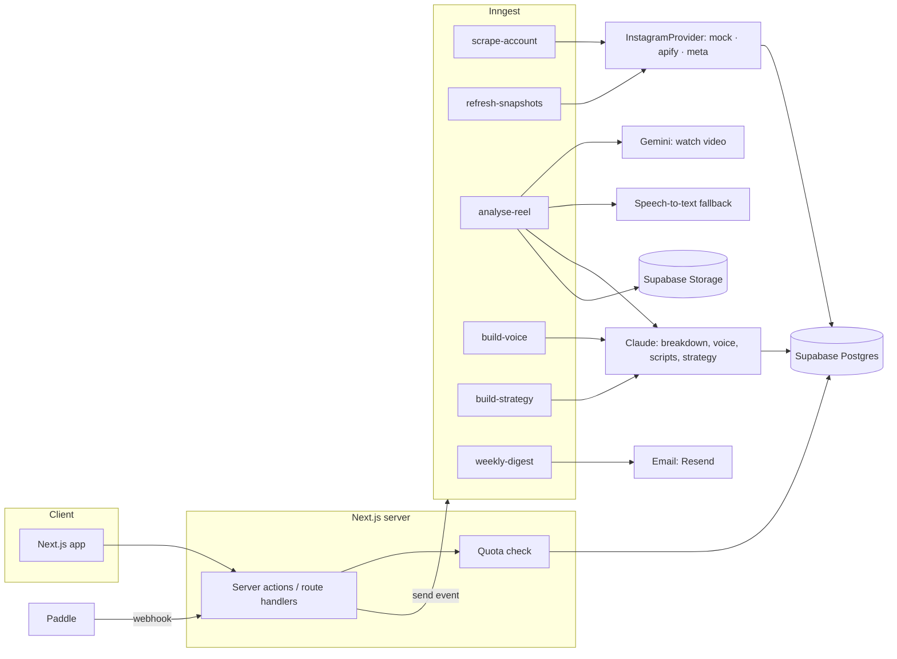

# 05 · Architecture

## 1. System overview



## 2. Instagram data: the provider interface

All Instagram access goes through one interface so you can swap sources without touching the app.

```ts
// lib/data/instagram-provider.ts
export interface InstagramProvider {
  getProfile(handle: string): Promise<IgProfile | null>;           // null = not found or private
  listReels(handle: string, opts: { limit: number; since?: Date }): Promise<IgReel[]>;
  getReel(shortcode: string): Promise<IgReel | null>;              // fresh counts for snapshots
  getMediaUrl(shortcode: string): Promise<string | null>;          // short-lived video URL for analysis
  searchAccounts?(query: string, limit: number): Promise<IgProfile[]>; // niche discovery (optional)
}

export type IgProfile = {
  handle: string; name: string; avatarUrl: string; bio: string;
  followers: number; following: number; mediaCount: number;
  isPrivate: boolean; isBusinessOrCreator: boolean;
};

export type IgReel = {
  shortcode: string; ownerHandle: string; postedAt: string; // ISO
  caption: string; views: number | null; likes: number | null; comments: number;
  durationSec: number | null; thumbnailUrl: string; permalink: string;
  type: "reel" | "carousel" | "image"; audioTitle?: string;
};
```

| Implementation | When | Notes |
| --- | --- | --- |
| `MockProvider` | `MOCK_MODE=true`, tests, Milestones 0–5 | Reads `fixtures/sample-data.json`; deterministic. |
| `ApifyProvider` | Fastest path to real data | Calls an Apify Instagram reel/profile scraper actor by username. Many actors exist at roughly $0.5–$2.5 per 1,000 results. Pin one actor ID in env, map its output with a Zod schema, and expect field names to differ between actors. |
| `MetaProvider` | The official route | Instagram API with Facebook Login, `business_discovery` field. Returns public data for **Business or Creator** accounts only (followers, media, likes, comments, and reel `view_count`). Needs a Meta app, a connected Business/Creator account of the user, and app review. Personal accounts can't be read. |

**Recommended path**: build with Mock → test with Apify on a small scale → move production traffic to Meta where it covers the account, keeping Apify as fallback only if your legal review allows it. See `docs/08-RESEARCH-NOTES.md` § Risks.

## 3. Outlier maths (`lib/outliers/`)

Pure, unit-tested functions. These definitions are shown to users in `UsualTooltip`, so keep the copy in sync.

**Usual views (baseline)** for an account at time *t*:
- Take the account's reels posted in the last 90 days, **excluding** reels younger than 3 days (still growing) and the reel being scored.
- Keep the most recent 30 of those. If fewer than 8, mark the baseline `low_confidence`.
- Baseline = **median** of their views. (Median, not mean, so one viral reel doesn't inflate it.)
- Tooltip copy: "Usual views = the median of their last 30 reels older than 3 days."

**Multiple** = reel views ÷ baseline, rounded to 1 decimal below 10 and whole numbers above.

**Is outlier** when all are true:
- multiple ≥ `OUTLIER_MIN_MULTIPLE` (default 3; sparse fallback 2)
- views ≥ 1,000 (avoid tiny-account noise)
- baseline not `low_confidence`, or multiple ≥ 5

**Breaking now (default sort)** uses snapshots:
- velocity = views gained per hour over the last 24 h ÷ baseline
- score = multiple × (1 + velocity) × recency, where recency = 1 for ≤ 7 days, then halves every 7 days
- Without two snapshots yet, fall back to multiple × recency.

**Same definition for the user's own reels** ("your usual") — no separate formula.

Edge cases to test: account with < 8 reels; reel with null views (some carousels); baseline 0; ties; reel exactly 3 days old.

## 4. Background jobs (Inngest)

| Job | Trigger | What it does |
| --- | --- | --- |
| `creator/onboard` | user finishes handle step | profile → last 30 reels → transcribe top 21 by views → `voice/build` → `strategy/build` → suggest tracked accounts |
| `account/scrape` | account added; daily cron per account (staggered) | fetch latest 30 reels, upsert, recompute baseline, mark outliers, emit `reel/outlier-found` |
| `snapshots/refresh` | every 6 h for reels < 7 days old on tracked accounts | store view counts for growth chart and Breaking now |
| `reel/analyse` | user clicks Break it down (or free example on onboarding) | get media URL → Gemini watch → (STT fallback) → Claude breakdown → validate → save → delete temp file |
| `voice/build` | onboarding; source toggled; sample added | Claude builds voice profile from transcripts + samples; new version row |
| `strategy/build` | onboarding; "What changed?" applied | Claude writes positioning, audience, goals, pillars; runs conflict check |
| `alerts/breakout` | `reel/outlier-found` with multiple ≥ 5 within 24 h | in-app notification, max 2 per week per creator |
| `digest/weekly` | Monday 08:00 in user's time zone | top 5 outliers + one idea per pillar → email |

Concurrency: limit provider calls per key; retry with backoff (3 tries); idempotency key = shortcode or account+date.

## 5. AI pipeline

| Step | Model | Input | Output schema |
| --- | --- | --- | --- |
| Watch the reel | Gemini Flash (current model, e.g. `gemini-3.5-flash`), native video input | video file or URL | `VideoObservation` (transcript with timestamps, on-screen text per second range, shot changes, visual description of first 3 s) |
| Transcript fallback | `gpt-4o-mini-transcribe` or Deepgram Nova-3 multilingual | audio | text + segments |
| Breakdown | Claude `claude-sonnet-5-5` | VideoObservation + metrics + creator niche | `Breakdown` |
| Angle previews | Claude `claude-haiku-5-5` | Breakdown + creator context | 3 one-liners |
| Script | Claude `claude-sonnet-5-5` | Breakdown + angle + Strategy + Voice + don't-use | `Script` |
| Studio edits | Claude `claude-sonnet-5-5` with tools `update_lines`, `set_hook`, `set_caption` | current script + message | tool calls (applied as a patch with undo) |
| Voice profile | Claude `claude-sonnet-5-5` | transcripts + samples | `VoiceProfile` |
| Strategy + conflict check | Claude `claude-sonnet-5-5` | profile, interview, reels summary, voice | `Strategy`, `VoiceConflict` |
| Pillar tagging | Claude `claude-haiku-5-5` (batch) | reel transcript/caption + pillars | pillar id or null |

Why two vendors: Claude doesn't accept video input; Gemini watches the video once and Claude does the writing. Model IDs change, so keep them in env (`CLAUDE_MODEL_SMART`, `CLAUDE_MODEL_FAST`, `GEMINI_VIDEO_MODEL`) and check the providers' model pages before launch.

Prompting rules (details in `06-AI-PROMPTS.md`):
- Structured output only (JSON matching Zod schemas); use the Claude API's tool use / structured output so the model fills a schema.
- Put the long, stable parts (Strategy, Voice) first and enable **prompt caching** on them, since every script call reuses them.
- Breakdowns are cached per reel and shared across users; scripts are per creator.

## 6. Cost model (rough, verify current prices)

| Item | Unit cost (Nov 2026 public prices) | Example monthly use, 1 active Creator-plan user |
| --- | --- | --- |
| Reel scraping (Apify actors) | ~$0.5–2.5 per 1,000 results | 15 accounts × 30 reels × 30 days ≈ 13.5K results → ~$7–34; refresh only new reels to cut this ~5× |
| Video understanding (Gemini Flash) | priced per token; a 45 s reel is well under 1 cent | 50 breakdowns → < $0.50 |
| Transcription fallback | ~$0.003–0.009 per minute | negligible |
| Claude (breakdown + script) | per token; a few cents per call | 50 breakdowns + 30 scripts → ~$2–5 |

Main cost lever is scraping: cache across users (many creators track the same accounts), refresh daily not hourly, and fetch only reels newer than the last scrape.

## 7. Auth, security, privacy

- Supabase Auth (Google, magic link). Every table has RLS keyed on workspace membership; shared tables (`ig_accounts`, `reels`, `breakdowns`) are read-only to users and written only by jobs with the service role.
- Secrets only on the server. Signed, short-lived URLs for Storage.
- Delete downloaded video files right after analysis; store thumbnails and transcripts only.
- Rate-limit AI endpoints per user (e.g. 30 requests/minute) and per workspace by quota.
- Log AI cost per call (`ai_calls` table) to watch margins.
- Respect deletion: deleting a creator removes its scripts, strategy, voice, samples and threads.

## 8. Environment variables (`.env.example`)

```
MOCK_MODE=true
NEXT_PUBLIC_SUPABASE_URL=
NEXT_PUBLIC_SUPABASE_ANON_KEY=
SUPABASE_SERVICE_ROLE_KEY=
INNGEST_EVENT_KEY=
INNGEST_SIGNING_KEY=
INSTAGRAM_PROVIDER=mock            # mock | apify | meta
APIFY_TOKEN=
APIFY_REELS_ACTOR_ID=
APIFY_PROFILE_ACTOR_ID=
META_APP_ID=
META_APP_SECRET=
META_IG_USER_ID=                   # the app's own IG business account used for business_discovery calls
META_ACCESS_TOKEN=
ANTHROPIC_API_KEY=
CLAUDE_MODEL_SMART=claude-sonnet-5-5
CLAUDE_MODEL_FAST=claude-haiku-5-5
GEMINI_API_KEY=
GEMINI_VIDEO_MODEL=gemini-3.5-flash
STT_PROVIDER=openai                # openai | deepgram
OPENAI_API_KEY=
DEEPGRAM_API_KEY=
PADDLE_API_KEY=
PADDLE_WEBHOOK_SECRET=
PADDLE_PRICE_CREATOR_MONTHLY=
PADDLE_PRICE_PRO_MONTHLY=
RESEND_API_KEY=
OUTLIER_MIN_MULTIPLE=3
```

## 9. Testing

- Unit: `lib/outliers` (all edge cases above), quota logic, Zod schemas against fixture outputs, prompt builders (snapshot tests).
- Integration: each Inngest job with the mock provider and mocked AI clients.
- E2E (Playwright, mock mode): onboarding → feed has ≥ 15 cards; reel → breakdown → write script → appears in Scripts; free limit → upgrade card.
